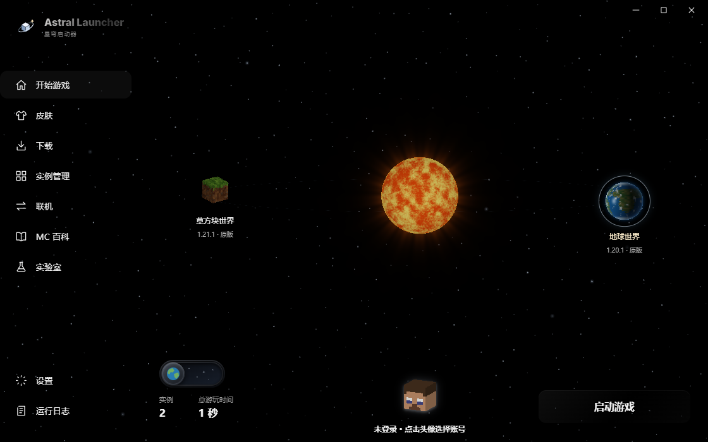
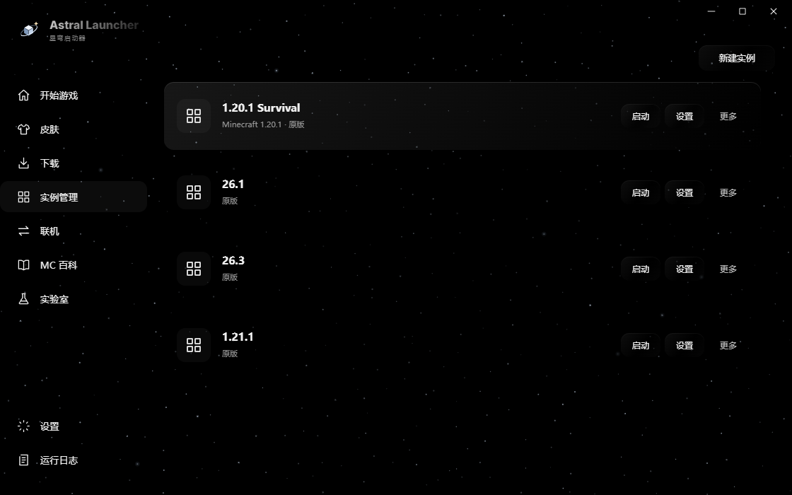
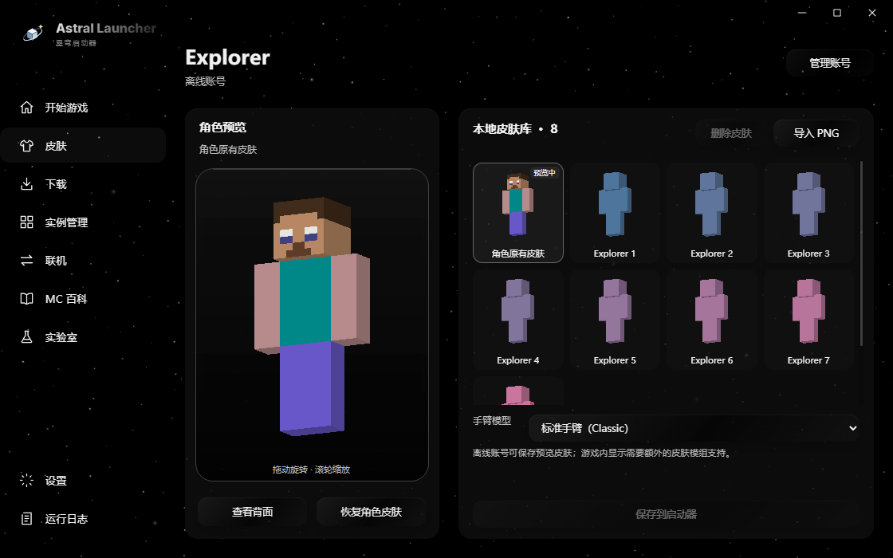
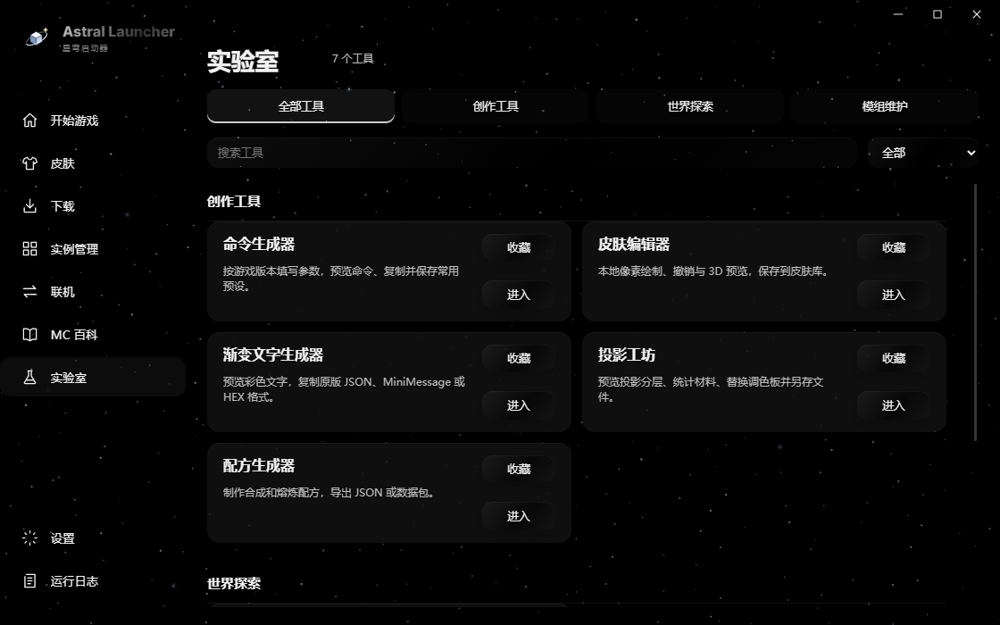

# Astral Launcher · 星穹启动器

面向 Windows 的 Minecraft Java 启动器。以太阳和星球呈现实例，用一个窗口管理游戏、模组、皮肤、存档和联机。

**[下载最新版本](https://github.com/asddaqs/Astral-Launche/releases/latest)** · **[使用指南](docs/使用指南.md)** · **[常见问题](docs/常见问题.md)** · **[反馈问题](https://github.com/asddaqs/Astral-Launche/issues/new/choose)** · **[更新记录](CHANGELOG.md)**

## 开始使用

1. 首次使用下载最新 1.4.2 Release 附件中的 `AstralLauncher.exe`。
2. 放入可写文件夹后运行。优先使用系统 WebView2；缺失时自动从微软下载并验证签名后安装，无需另下便携 ZIP。
3. 添加账号，在「下载」选择游戏版本；安装完成后到首页选择实例并启动。

推荐 Windows 10 / 11 x64。启动器约 8 MiB；缺少 WebView2 时首次准备需联网下载运行环境，其占用空间另计。已有完整外置内核可作为备用。游戏、资源、所需 Java 和在线功能仍需联网下载。运行后请保留生成的 `Astral` 文件夹。

| 下载文件 | 用途 |
| --- | --- |
| `AstralLauncher.exe` | 轻量单文件版，首次使用及更新均可用 |
| 旧版便携 ZIP（如有） | 旧版外置内核分发方式 |
| `AstralLauncher.exe.sha256` | 核对程序完整性 |
| `update.json` | 启动器自动更新清单 |

GitHub 自动生成的 **Source code** 压缩包不含可运行的启动器。此仓库用于程序与文档分发。

## 功能

- **实例与下载**：原版及兼容的 Fabric、Quilt、Forge、NeoForge；多源游戏下载、失败续传，主动取消清理未完成内容。
- **社区资源**：聚合 Modrinth 与 CurseForge，可单独选择来源，展示项目图片、中文与英文名称及匹配的前置版本。
- **实例管理**：快捷启动、文件夹入口、更换加载器、拖入整合包、导出 `.mrpack`；增加模组批量更新和截图相册。更换加载器保留模组，请自行确认兼容性。
- **皮肤**：3D 预览、PNG 导入、本地皮肤删除，以及受账号服务支持的在线换肤。
- **存档保护**：世界导入与导出，默认启动前备份并保留最近 5 份；恢复前额外保护当前存档。
- **诊断与 AI**：本地崩溃诊断；统一聊天窗口支持崩溃分析、确认修复与撤销、Mod 翻译、兼容 Mod 查找和确认安装。在线 AI 需自备兼容接口、模型与密钥。
- **联机**：EasyTier 六位房间号或二维码，默认免费社区共享节点，可自定义节点；保留局域网端口识别、环境码比较和服务器收藏。首次准备约 32 MB 官方组件，组网助手需要管理员授权。详见 [联机说明](docs/EasyTier联机.md)。
- **实验室**：配方、命令、渐变文本、皮肤编辑、投影与种子地图工具；另有内置 MC 百科浏览器。
- **外观**：纯黑星空、圆形 / 方块地球滑动切换、独立草方块外观、桌面透明星光启动动画和减少动态效果支持；兼容系统使用 Windows 原生平滑圆角。
- **存储管理**：后台统计磁盘占用，预览后清理可重建缓存，保护实例、模组、世界、截图及备份。

## 界面预览

以下使用演示实例数据。

## 更新与数据

在「设置 → 启动器更新」填写 `https://github.com/asddaqs/Astral-Launche`。更新下载后校验 SHA256、大小和版本，正常退出启动器后安装。

设置、账号、本地皮肤、日志和备份集中在 `Astral/`；默认游戏实例、缓存与 Java 位于 `.minecraft/`。首次升级会迁移旧布局，原始配置保存在 `Astral/migration-backup`。更改游戏安装位置只影响后续实例，外部已有实例不会自动搬迁。重要存档建议另存一份。

## 使用边界与反馈

联机优先尝试 P2P，无法直连时可由免费社区节点中转；节点可用性和带宽由提供者决定。已验证无虚拟网卡的真实进程节点发现、房间隔离和端口转发；实际管理员授权、TUN 网卡及跨设备进服仍需首次交互验证。原版游戏中的第三方皮肤显示仍受账号与服务器限制。AI 建议可能有误，修复及安装操作会要求确认。

反馈请提供启动器版本、系统版本、游戏及加载器版本、复现步骤和脱敏后的错误片段。**不要上传账号配置、访问令牌、API 密钥或私人存档。** 详见 [反馈说明](CONTRIBUTING.md)。

Astral Launcher 非 Mojang / Microsoft 官方产品。Minecraft、各资源平台及第三方组件的名称与权利属于其各自所有者。请合法使用游戏和社区资源；本仓库未授予启动器源码的开源许可。第三方声明见 [THIRD-PARTY-NOTICES.md](THIRD-PARTY-NOTICES.md)。
